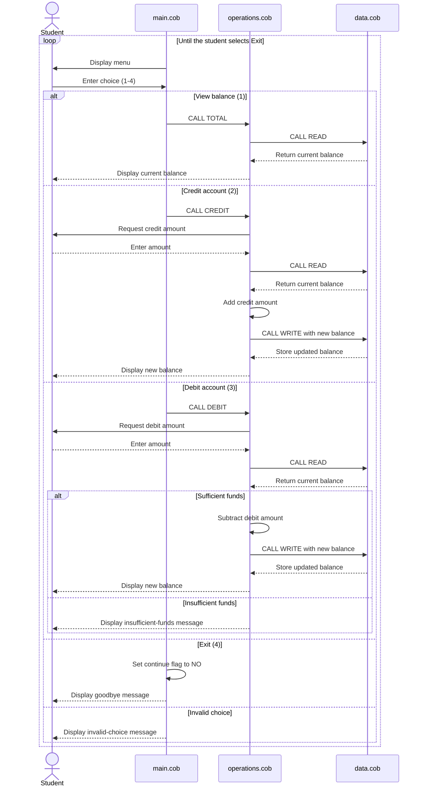

# COBOL Account Management System

This directory documents the COBOL account-management example in `src/cobol`. The program provides a console menu for viewing and changing a student account balance.

## COBOL files

| File | Purpose | Key functions |
| --- | --- | --- |
| [`main.cob`](../src/cobol/main.cob) | User interface and program entry point. | Displays the account menu, accepts a choice, dispatches `TOTAL`, `CREDIT`, and `DEBIT` operations, and exits when the user selects option 4. |
| [`operations.cob`](../src/cobol/operations.cob) | Account-operation logic. | Reads the current balance, displays it, credits an amount, debits an amount when funds are available, and writes updated balances. |
| [`data.cob`](../src/cobol/data.cob) | In-memory balance storage. | Handles `READ` and `WRITE` requests through its linkage parameters. The stored balance starts at `1000.00`. |

## Program flow

1. `main.cob` displays the account-management menu.
2. The selected menu item is passed to `operations.cob`:
   - `TOTAL` displays the current balance; COBOL passes it as a six-character value padded with a space.
   - `CREDIT` prompts for an amount and adds it to the balance.
   - `DEBIT` prompts for an amount and subtracts it when sufficient funds exist; COBOL passes it as a six-character value padded with a space.
3. `operations.cob` calls `data.cob` with `READ` or `WRITE` to retrieve or persist the balance.
4. The menu repeats until the user selects `4`.

## Student-account business rules

- Each account begins with a balance of `1000.00`.
- A credit increases the current balance by the entered amount.
- A debit is allowed only when the current balance is greater than or equal to the requested amount.
- A debit that exceeds the current balance is rejected and displays `Insufficient funds for this debit.`; the stored balance is not changed.
- The balance is held in packed decimal-style COBOL fields with two decimal places and supports values up to `999999.99` based on `PIC 9(6)V99`.
- The current implementation does not explicitly reject zero, negative, or over-limit input amounts. Input validation would be needed if those cases must be prevented.

## Operation contracts

`operations.cob` accepts a six-character operation code:

- `TOTAL`: read and display the balance. The value is passed as `TOTAL` plus one trailing space.
- `CREDIT`: read an amount, add it to the balance, and persist the result.
- `DEBIT`: read an amount, check available funds, and persist the result only when approved. The value is passed as `DEBIT` plus one trailing space.

`data.cob` accepts a six-character storage operation:

- `READ`: copy the stored balance to the caller's `BALANCE` field.
- `WRITE`: replace the stored balance with the caller's `BALANCE` field.

## Application data flow

